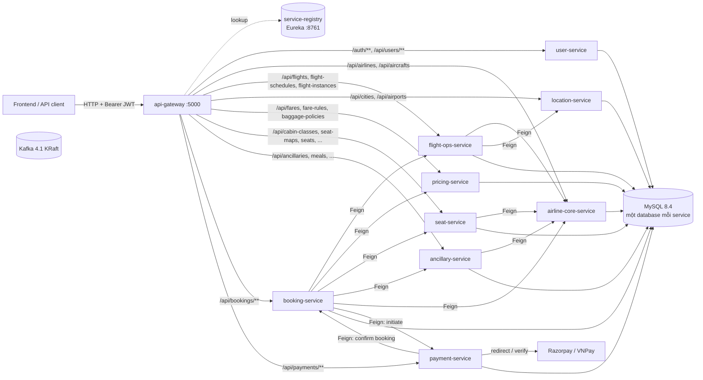

# Airline Microservices

Backend cho nền tảng bán vé máy bay nhiều hãng. Admin hệ thống duyệt hãng bay. Chủ hãng (`ROLE_AIRLINE_OWNER`) quản lý tàu bay, chuyến bay, lịch bay, sơ đồ ghế, giá vé và dịch vụ bổ trợ. Khách hàng (`ROLE_USER`) đặt chỗ cho nhiều hành khách, chọn ghế, suất ăn, bảo hiểm, rồi thanh toán qua Razorpay hoặc VNPay.

Java 17 · Spring Boot 4.0.7 · Spring Cloud 2025.1.0 (Eureka, Gateway MVC, OpenFeign) · MySQL 8.4 · Maven multi-module · Jib · Docker Compose.

## Nghiệp vụ theo service

| Service | Port | Database | Phạm vi |
|---|---|---|---|
| `api-gateway` | 5000 | — | Điểm vào duy nhất. Verify JWT, kiểm tra role, gắn header `X-User-Id` / `X-User-Email` / `X-User-Roles` rồi forward qua Eureka |
| `service-registry` | 8761 | — | Eureka server |
| `user-service` | 5001 | `airline_user` | Đăng ký, đăng nhập (`/auth/signup`, `/auth/login`), ký JWT, profile. Seed tài khoản `ROLE_SYSTEM_ADMIN` từ `ADMIN_EMAIL`/`ADMIN_PASSWORD` |
| `airline-core-service` | 5002 | `airline` | `Airline` (vòng đời `approve` / `suspend` / `ban`), `Aircraft` và số ghế theo hạng |
| `flight-ops-service` | 5003 | `airline_flight` | `Flight` (tuyến bay của hãng), `FlightSchedule` (ngày bay trong tuần, tạo sẵn `FlightInstance`), `FlightInstance` (chuyến cụ thể theo ngày, `FlightStatus`) |
| `location-service` | 5004 | `airline_location` | `City`, `Airport`, tìm thành phố theo tên/mã quốc gia |
| `pricing-service` | 5005 | `airline_pricing` | `Fare` theo cặp (flight, cabin class), `FareRules`, `BaggagePolicy`, tìm giá |
| `seat-service` | 5006 | `airline_seat` | `CabinClass`, `SeatMap`, sinh `Seat` từ seat map, `FlightInstanceCabin`, `SeatInstance` (trạng thái ghế theo từng chuyến, khoá lạc quan `@Version`) |
| `ancillary-service` | 5008 | `airline_ancillary` | `Ancillary` (kèm `InsuranceCoverage`), `Meal`, `FlightMeal`, `FlightCabinAncillary`, tính tổng giá dịch vụ bổ trợ |
| `booking-service` | 5009 | `airline_booking` | `Booking` (`PENDING → CONFIRMED / CANCELLED / EXPIRED`), `Passenger`, `Ticket`. Tổng tiền = fare + ghế + ancillary + suất ăn |
| `payment-service` | 5010 | `airline_payment` | Khởi tạo và xác thực thanh toán Razorpay / VNPay, xác nhận booking sau khi thanh toán thành công |

`common-lib` là jar dùng chung: DTO (`payload/request`, `payload/response`), enum, `@Embeddable`, `BaseEntity` (khoá chính UUIDv7, `createdAt`/`updatedAt`) và exception chung. Mỗi service có database riêng và không dùng annotation quan hệ JPA. Service tham chiếu chéo nhau bằng cột `UUID` và lấy dữ liệu qua Feign (`POST /api/<resource>/batch-by-ids`).

## Kiến trúc



Mọi service nghiệp vụ đều đăng ký với Eureka và gọi nhau theo tên service (`lb://`). Chỉ `/auth/**` là public. Các route khác bắt buộc có JWT. Thao tác ghi (`POST/PUT/PATCH/DELETE`, trừ `batch-by-ids`) yêu cầu `ROLE_SYSTEM_ADMIN` hoặc `ROLE_AIRLINE_OWNER` tuỳ route (xem `cloud/api-gateway/.../RouteConfig.java`). Kafka đã có trong Compose, nhưng chưa có service nào publish hoặc consume.

## Yêu cầu

- JDK 17
- Maven 3.9+ (repo không có Maven Wrapper ở root; các file `mvnw` trong từng service là phần thừa, không dùng)
- Docker + Docker Compose v2

Luôn chạy `mvn` từ thư mục root để `common-lib` và version do parent POM quản lý được áp dụng.

## Cấu hình

```bash
cp .env.example .env
# Bắt buộc: JWT_SECRET (>= 32 ký tự). Nên đặt ADMIN_EMAIL / ADMIN_PASSWORD để có tài khoản admin đầu tiên.
```

`user-service`, `api-gateway` và `payment-service` tự đọc `.env` ở root (`spring.config.import: optional:file:../../.env`). Docker Compose cũng đọc `.env` ở root.

## Chạy local: service trên máy, hạ tầng trong Docker

1. Khởi động MySQL (`localhost:3306`, `root` / `123456`) và Kafka (`localhost:9092`):

   ```bash
   docker compose -f docker-compose.dev.yml up -d
   ```

   `docker/mysql/init.sql` tự tạo 9 database ở lần chạy đầu tiên, khi volume còn trống. Bảng được Hibernate tạo bằng `ddl-auto: update`. Repo không dùng Flyway/Liquibase. Nếu dùng MySQL cài sẵn trên máy thì chạy `docker/mysql/init.sql` thủ công, và đảm bảo user `root` có mật khẩu `123456` (giá trị đang hardcode trong `application.yaml` của mỗi service).

2. Build toàn bộ reactor:

   ```bash
   mvn clean install -DskipTests
   ```

3. Chạy theo thứ tự: registry, các service, rồi gateway. Mỗi lệnh chạy trong một terminal riêng:

   ```bash
   mvn -pl cloud/service-registry spring-boot:run
   mvn -pl services/user-service spring-boot:run
   mvn -pl services/airline-core-service spring-boot:run
   mvn -pl services/location-service spring-boot:run
   mvn -pl services/flight-ops-service spring-boot:run
   mvn -pl services/pricing-service spring-boot:run
   mvn -pl services/seat-service spring-boot:run
   mvn -pl services/ancillary-service spring-boot:run
   mvn -pl services/booking-service spring-boot:run
   mvn -pl services/payment-service spring-boot:run
   mvn -pl cloud/api-gateway spring-boot:run
   ```

4. Kiểm tra:
   - Eureka dashboard: http://localhost:8761 (đủ 10 instance)
   - Health của gateway: `curl http://localhost:5000/actuator/health`
   - Đăng nhập bằng tài khoản admin vừa seed:

     ```bash
     curl -X POST http://localhost:5000/auth/login \
       -H "Content-Type: application/json" \
       -d '{"email":"<ADMIN_EMAIL>","password":"<ADMIN_PASSWORD>"}'
     ```

## Chạy toàn bộ bằng Docker Compose

Image backend được build bằng Jib. Compose không tự build image backend.

```bash
mvn clean install -DskipTests
mvn compile jib:dockerBuild                       # tạo image nitditto/<module>:0.0.1-SNAPSHOT

docker compose up -d                              # MySQL, Kafka, Eureka, gateway, 9 service
docker compose --profile full up -d --build       # thêm frontend (build từ ../frontend, cổng 5173)

docker compose ps
docker compose logs -f api-gateway
```

Cổng mở ra host: gateway `5000`, Eureka `8761`, MySQL `127.0.0.1:3307`, Kafka `127.0.0.1:9092`, frontend `5173` (khi dùng profile `full`).

Dừng stack:

```bash
docker compose --profile full down                # giữ dữ liệu
docker compose --profile "*" down -v              # xoá luôn volume MySQL + Kafka
```

Sau khi sửa code, chạy lại `mvn compile jib:dockerBuild` (thêm `-pl services/<name> -am` nếu chỉ build một module) rồi `docker compose up -d`.

Script vá dữ liệu cũ nằm trong `docker/mysql/migrations/`. Các script này không tự chạy, cần chạy tay trên đúng database khi cần.

## Biến môi trường

| Biến | Dùng bởi | Mặc định | Ghi chú |
|---|---|---|---|
| `JWT_SECRET` | user-service, api-gateway | — (bắt buộc) | Hai service phải dùng cùng một giá trị, tối thiểu 32 ký tự |
| `ADMIN_EMAIL` / `ADMIN_PASSWORD` | user-service | rỗng | Để trống thì không seed admin |
| `RAZORPAY_KEY_ID` / `RAZORPAY_KEY_SECRET` | payment-service | rỗng | Để trống thì service vẫn chạy nhưng từ chối mọi request Razorpay |
| `RAZORPAY_CALLBACK_BASE_URL` | payment-service | `http://localhost:5173` | URL frontend nhận redirect sau khi thanh toán |
| `VNPAY_TMN_CODE` / `VNPAY_HASH_SECRET` | payment-service | rỗng | Để trống thì VNPay bị tắt |
| `VNPAY_PAY_URL` | payment-service | `https://sandbox.vnpayment.vn/paymentv2/vpcpay.html` | |
| `VNPAY_RETURN_URL` | payment-service | `http://localhost:5173/payment/result` | |
| `CORS_ALLOWED_ORIGINS` | api-gateway | rỗng (chặn mọi origin) | Danh sách origin, phân tách bằng dấu phẩy |
| `EUREKA_URL` | api-gateway | `http://localhost:8761/eureka/` | |
| `MYSQL_ROOT_PASSWORD` | Compose (mysql + service) | `123456` | Đổi giá trị sau lần khởi tạo đầu thì phải `down -v` |
| `DOCKER_IMAGE_PREFIX` / `IMAGE_TAG` | Compose | `nitditto` / `0.0.1-SNAPSHOT` | Phải khớp với `docker.image.prefix` và version trong `pom.xml` |
| `FRONTEND_PORT` | Compose | `5173` | |
| `VITE_API_BASE_URL`, `VITE_ENABLE_BACKEND_SHIMS`, `VITE_BOOKING_HOLD_MINUTES` | Compose (build frontend) | rỗng / `true` / `15` | Chỉ dùng với profile `full` |

Trong Compose, datasource, Eureka và Kafka của từng service được ghi đè qua `SPRING_DATASOURCE_URL`, `SPRING_DATASOURCE_PASSWORD`, `EUREKA_CLIENT_SERVICEURL_DEFAULTZONE` và `SPRING_KAFKA_BOOTSTRAP_SERVERS`.

## Test

Test hiện có:

| Loại | Lớp | Cần gì |
|---|---|---|
| Unit | `FareMapperTest` (pricing), `FlightInstanceServiceImplTest` (flight-ops), `PaymentServiceImplTest`, `RazorpayServiceTest`, `VNPayServiceTest` (payment) | Không cần hạ tầng |
| Integration / E2E | `AuthE2ETest` (user-service, dùng DB `airline_user_test`), `GatewayJwtE2ETest` (api-gateway) | MySQL `localhost:3306`, `JWT_SECRET` |
| Context load | `*ApplicationTests` ở mỗi module | MySQL `localhost:3306` có sẵn database của service, `JWT_SECRET` |

```bash
docker compose -f docker-compose.dev.yml up -d   # MySQL cho test integration / context load

mvn test                                          # toàn bộ reactor
mvn -pl services/payment-service -am test         # một module (-am để build kèm common-lib)
mvn -pl services/pricing-service test -Dtest=FareMapperTest
mvn -pl services/payment-service test -Dtest=VNPayServiceTest#methodName
```

## Cấu trúc repo

```
.
├── pom.xml                  # parent POM: version Java / Spring Boot / Spring Cloud / Jib
├── common-lib/              # DTO, enum, embeddable, BaseEntity, exception chung
├── cloud/
│   ├── service-registry/    # Eureka
│   └── api-gateway/         # Spring Cloud Gateway MVC + JWT
├── services/                # 9 service nghiệp vụ, cùng layout controller/service/repository/model/mapper/client/config
├── docker/mysql/            # init.sql, migrations/ chạy tay
├── docker-compose.yml       # full stack
├── docker-compose.dev.yml   # chỉ MySQL + Kafka
└── docs/                    # quy ước phát triển và tài liệu thiết kế
```

Quy ước code, quy ước git và rule cho từng tầng nằm ở [`CLAUDE.md`](CLAUDE.md) và [`docs/`](docs/README.md).
