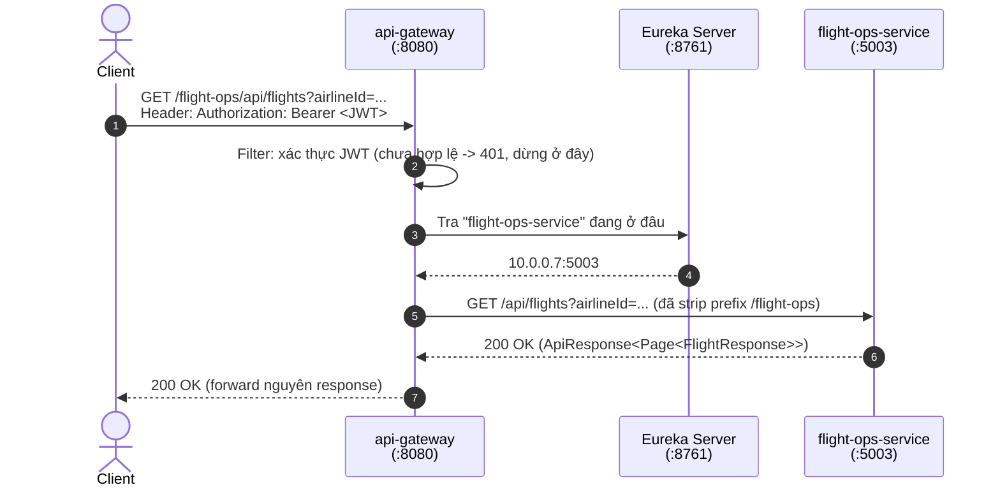

# API Gateway & Routing (Spring Cloud Gateway)

> **Trạng thái**: ⬜ **Chưa triển khai** — `cloud/api-gateway` bị comment trong
> [`cloud/pom.xml`](../../cloud/pom.xml) (`<!--    <module>api-gateway</module>-->`), chưa có module
> thật trong repo. File này là tài liệu thiết kế cho [`ROADMAP.md`](../ROADMAP.md) Section 14.
> **Tài liệu liên quan**: [`spring-cloud-service-discovery.md`](spring-cloud-service-discovery.md) ·
> [`../development/07-security.md`](../development/07-security.md) · [`../../CLAUDE.md`](../../CLAUDE.md).

---

## 1. 5W1H

| | Trả lời |
| :--- | :--- |
| **What** — Là gì? | Một service đứng **trước** toàn bộ 7 microservice, là điểm vào duy nhất (single entry point) cho client bên ngoài (web/mobile app). Dùng **Spring Cloud Gateway** (không dùng Zuul — Zuul 1 đã deprecated, Zuul 2 không còn được Spring Cloud tích hợp chính thức). |
| **Why** — Tại sao cần? | Hiện tại client muốn gọi API phải **tự biết** `airline-core-service` ở port 5002, `flight-ops-service` ở port 5003... — tức là client phải biết chi tiết hạ tầng nội bộ, giống hệt vấn đề mà Eureka giải quyết cho giao tiếp *nội bộ*, nhưng ở đây là cho giao tiếp *từ bên ngoài vào*. Không có Gateway: mỗi service phải tự cài CORS, tự implement rate limiting, tự parse JWT — lặp lại 7 lần thay vì 1 lần. |
| **Who** — Ai vận hành? | Đội hạ tầng/backend chung — Gateway không thuộc riêng domain nào (khác với `user-service` hay `pricing-service` là service nghiệp vụ). Đây là lý do nó nằm ở `cloud/` (ngang hàng `service-registry`), không phải `services/`. |
| **When** — Khi nào cần? | Khi hệ thống bắt đầu có client thật (web/mobile) gọi vào, hoặc khi cần một chỗ tập trung để enforce auth/rate-limit trước khi vào bất kỳ service nào. **Chưa cấp thiết** khi hệ thống mới có giao tiếp nội bộ service-to-service (đó là việc của Eureka/Feign) và chưa expose ra ngoài. |
| **Where** — Đặt ở đâu? | Module Maven mới `cloud/api-gateway`, thêm vào `<modules>` của [`cloud/pom.xml`](../../cloud/pom.xml). Bản thân Gateway **không có entity, không có database** — nó chỉ định tuyến (route) request tới service đích qua Eureka. |
| **How** — Vận dụng ra sao? | Xem §3, §4. |

---

## 2. Gateway giải quyết vấn đề gì mà Eureka + Feign chưa giải quyết

Dễ nhầm Gateway với Eureka vì cả hai đều "biết địa chỉ mọi service". Khác biệt cốt lõi:

| | Eureka | API Gateway |
| :--- | :--- | :--- |
| Ai là người gọi | **Service khác** trong hệ thống (`flight-ops-service` tra `airline-core-service`) | **Client bên ngoài** (browser, mobile app) |
| Có định tuyến HTTP thật không | Không — chỉ trả về danh sách IP:port, việc gọi là do client tự làm (`RestTemplate`/Feign) | Có — Gateway **là** một reverse proxy, tự forward request |
| Có xử lý cross-cutting (auth, CORS, rate limit) không | Không | Có — đây là lý do chính để tồn tại |
| Điểm chịu lỗi nếu down | Service không tra được registry mới → dùng cache cũ, dịch vụ nội bộ vẫn chạy | **Toàn hệ thống không nhận được request nào từ bên ngoài** — là single point of failure quan trọng nhất |

Nói ngắn gọn: Eureka phục vụ giao tiếp **Đông–Tây** (service ↔ service), Gateway phục vụ giao tiếp
**Bắc–Nam** (client ↔ hệ thống).

---

## 3. Kiến trúc & luồng request



Client chỉ cần biết **một địa chỉ duy nhất** (`api-gateway:8080`) và **một quy ước path**
(`/<ten-service-rut-gon>/**`), không cần biết `flight-ops-service` đang chạy port bao nhiêu hay có
bao nhiêu instance.

---

## 4. Cấu hình định tuyến (khi triển khai)

### 4.1. Dependency

```xml
<dependency>
    <groupId>org.springframework.cloud</groupId>
    <artifactId>spring-cloud-starter-gateway-server-webflux</artifactId>
</dependency>
<dependency>
    <groupId>org.springframework.cloud</groupId>
    <artifactId>spring-cloud-starter-netflix-eureka-client</artifactId>
</dependency>
```

Lưu ý: Spring Cloud Gateway chạy trên **WebFlux** (reactive, Netty), không phải Spring MVC/Tomcat
như 7 service còn lại của dự án. Đây là lựa chọn bắt buộc của bản thân Spring Cloud Gateway, không
phải tuỳ chọn — cần lưu ý khi debug (không dùng blocking code trong custom filter).

### 4.2. Định tuyến tĩnh theo tên service (khai báo trong `application.yaml`)

```yaml
spring:
  cloud:
    gateway:
      server:
        webflux:
          discovery:
            locator:
              enabled: false   # tắt auto-route theo serviceId thô, tự khai route rõ ràng bên dưới
          routes:
            - id: airline-core-service
              uri: lb://airline-core-service        # lb:// = lookup qua Eureka + load balance
              predicates:
                - Path=/airline-core/**
              filters:
                - StripPrefix=1                       # /airline-core/api/airlines -> /api/airlines

            - id: flight-ops-service
              uri: lb://flight-ops-service
              predicates:
                - Path=/flight-ops/**
              filters:
                - StripPrefix=1

            - id: location-service
              uri: lb://location-service
              predicates:
                - Path=/location/**
              filters:
                - StripPrefix=1
```

**Vì sao không bật `discovery.locator.enabled: true`** (auto-route theo đúng tên Eureka): nó biến
mọi service đã đăng ký Eureka thành route công khai ngay lập tức, kể cả service nội bộ không nên
lộ ra ngoài. Khai route tường minh từng service là cách an toàn hơn và khớp với nguyên tắc "không
tự động thêm bề mặt tấn công" khi thiết kế Gateway.

### 4.3. Global filter — nơi tập trung xác thực JWT

Đây là lý do quan trọng nhất để có Gateway trong lộ trình dự án — JWT hiện tại (`JwtProvider`,
`JwtConstant` ở `user-service`, xem [`../development/07-security.md`](../development/07-security.md))
chỉ được validate **bên trong** từng service. Khi có Gateway, việc xác thực JWT nên chuyển lên đây,
**trước khi** request chạm vào bất kỳ service nghiệp vụ nào:

```java
@Component
public class JwtAuthenticationGatewayFilter implements GlobalFilter, Ordered {

    private static final List<String> PUBLIC_PATHS = List.of("/user/api/auth/login", "/user/api/auth/register");

    @Override
    public Mono<Void> filter(final ServerWebExchange exchange, final GatewayFilterChain chain) {
        final String path = exchange.getRequest().getURI().getPath();
        if (PUBLIC_PATHS.stream().anyMatch(path::startsWith)) {
            return chain.filter(exchange);
        }

        final String token = extractBearerToken(exchange);
        if (token == null || !jwtProvider.validate(token)) {
            exchange.getResponse().setStatusCode(HttpStatus.UNAUTHORIZED);
            return exchange.getResponse().setComplete();
        }

        // Forward userId đã xác thực xuống service đích qua header — thay cho việc client tự gửi
        // X-User-Id như các controller hiện tại đang nhận trực tiếp (AircraftController,
        // AirlineController...) — sau khi có Gateway, KHÔNG service nào nên tin X-User-Id
        // do client tự gửi nữa, chỉ tin header do chính Gateway gắn vào.
        final ServerHttpRequest mutatedRequest = exchange.getRequest().mutate()
            .header("X-User-Id", jwtProvider.extractUserId(token))
            .build();
        return chain.filter(exchange.mutate().request(mutatedRequest).build());
    }

    @Override
    public int getOrder() {
        return -1; // chạy trước routing filter mặc định
    }
}
```

**Đây là thay đổi bảo mật quan trọng cần ghi nhớ khi triển khai thật**: nhiều controller hiện tại
(`AircraftController`, `AirlineController`...) nhận `@RequestHeader("X-User-Id") UUID userId`
**trực tiếp từ client**, nghĩa là bất kỳ ai cũng có thể giả mạo header này để đóng vai người khác.
Khi có Gateway làm lớp xác thực tập trung, mỗi service nghiệp vụ phải cấu hình để **chỉ chấp nhận
traffic từ Gateway** (mạng nội bộ/Security Group), không expose port ra ngoài nữa — nếu không,
Gateway chỉ là lớp trang trí, request vẫn có thể đi vòng qua thẳng port service gốc và giả mạo
header như cũ.

### 4.4. Rate limiting (tuỳ chọn, cần Redis)

```yaml
filters:
  - name: RequestRateLimiter
    args:
      redis-rate-limiter.replenishRate: 10   # 10 request/giây ổn định
      redis-rate-limiter.burstCapacity: 20   # cho phép burst tới 20
```

Cần `spring-boot-starter-data-redis-reactive` + một Redis instance — phụ thuộc vào
[Section 20 Redis](../ROADMAP.md) chưa triển khai, nên rate limiting chỉ khả thi **sau** khi có
Redis, không phải bước đầu tiên.

---

## 5. Định vị Gateway trong reactor Maven

```
cloud/
├── pom.xml                 # thêm <module>api-gateway</module>, bỏ comment
├── service-registry/       # đã có
└── api-gateway/            # module mới
    ├── pom.xml              # parent = cloud, packaging = jar
    └── src/main/java/com/nitditto/
        ├── ApiGatewayApplication.java   # @SpringBootApplication, KHÔNG cần @EnableEurekaServer
        └── filter/
            └── JwtAuthenticationGatewayFilter.java
```

Không đặt entity, repository hay `@Entity` nào ở đây — đúng vai trò của Gateway là **định tuyến +
cross-cutting concern**, không phải nơi chứa business logic. Nếu thấy mình đang viết business logic
trong 1 filter, đó là dấu hiệu logic đang đặt sai chỗ — nên đẩy về service nghiệp vụ tương ứng.
