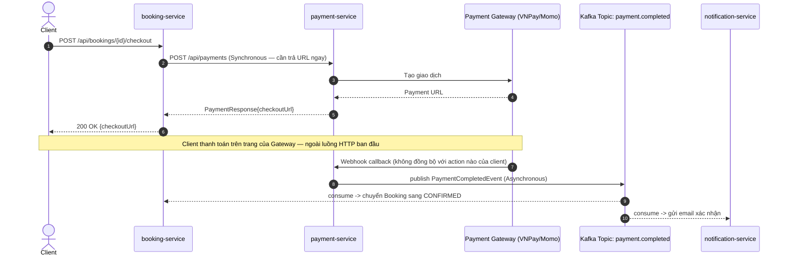

# Communication Patterns — Synchronous vs Asynchronous

> **Trạng thái**: 🟢 **Synchronous (REST) đã dùng** (`RestTemplate` + Eureka, xem
> [`inter-service-communication.md`](inter-service-communication.md)) | ⬜ **Asynchronous (Kafka)
> chưa triển khai** — chưa có dependency `spring-kafka` ở service nào trong repo.
> **Tài liệu liên quan**: [`ROADMAP.md`](../ROADMAP.md) Section 17 (Kafka) ·
> [`booking-service.md`](booking-service.md) · [`payment-service.md`](payment-service.md) ·
> [`../../CLAUDE.md`](../../CLAUDE.md).

File này không hướng dẫn cài Kafka (chưa tới lúc) — nó trả lời câu hỏi **quan trọng hơn**: *khi
nào chọn đồng bộ, khi nào chọn bất đồng bộ*, dựa trên chính các luồng nghiệp vụ đã tồn tại/đã lên
kế hoạch trong dự án.

---

## 1. 5W1H

| | Trả lời |
| :--- | :--- |
| **What** — Là gì? | Hai cách một service giao tiếp với service khác: **Synchronous** (gọi và **chờ** response ngay lập tức — HTTP/REST qua RestTemplate hoặc Feign) và **Asynchronous** (gửi một sự kiện rồi **đi tiếp**, không chờ ai xử lý xong — message broker như Kafka/RabbitMQ). |
| **Why** — Tại sao cần phân biệt? | Chọn sai pattern cho đúng tình huống là nguồn gốc phổ biến nhất của cascading failure và trải nghiệm chậm trong microservices. Dùng đồng bộ cho việc đáng lẽ nên bất đồng bộ (vd. gửi email xác nhận) khiến API chính bị chậm/lỗi vì một service phụ không liên quan trực tiếp tới response cần trả. Dùng bất đồng bộ cho việc cần biết kết quả ngay (vd. lấy giá vé để hiển thị) khiến logic phức tạp không cần thiết. |
| **Who** — Ai quyết định chọn pattern nào? | Người thiết kế luồng nghiệp vụ ở tầng Service — quyết định dựa trên **một câu hỏi duy nhất**: "Request gốc có cần đợi kết quả của lời gọi này để trả response cho client không?" (xem bảng quyết định ở §2). |
| **When** — Khi nào bắt buộc đồng bộ, khi nào bắt buộc bất đồng bộ? | Xem §2 và §3 — có ví dụ cụ thể lấy thẳng từ các luồng đã có trong dự án. |
| **Where** — Đặt ở đâu trong kiến trúc? | Đồng bộ: package `service/interservice` hoặc `client/` của service gọi (đã có ở `flight-ops-service`). Bất đồng bộ: `producer/`/`consumer/` (hoặc `event/`) của service phát/nhận sự kiện — chưa có package này trong repo vì chưa triển khai Kafka. |
| **How** — Vận dụng ra sao? | Xem §4 (ví dụ producer/consumer cho luồng Booking → Payment → Notification đã có trong roadmap). |

---

## 2. Bảng quyết định: khi nào chọn cái nào

| Câu hỏi | Trả lời "Có" → | Trả lời "Không" → |
| :--- | :--- | :--- |
| Client có cần dữ liệu này ngay trong response hiện tại không? | **Synchronous** (REST/Feign) | Cân nhắc Asynchronous |
| Việc này có làm request gốc **chậm đi đáng kể** nếu chờ (gửi email, ghi log audit, gọi 1 hệ thống bên thứ 3 chậm)? | Cân nhắc Asynchronous | Synchronous vẫn ổn |
| Nếu service nhận bị down tạm thời, request gốc có **bắt buộc phải fail theo** không? | **Synchronous** (fail cùng nhau là đúng ý đồ) | **Asynchronous** (message nằm trong queue, xử lý khi service hồi phục — không kéo request gốc theo) |
| Có nhiều hơn 1 service cần biết về sự kiện này không (1-to-many)? | **Asynchronous** (publish 1 lần, nhiều consumer tự đăng ký) | Synchronous đủ dùng (1-to-1) |
| Thứ tự xử lý có quan trọng và cần đảm bảo "đúng 1 lần" không? | Cân nhắc kỹ — cả hai đều cần thiết kế thêm (idempotency key cho REST, partition key + consumer idempotent cho Kafka) | — |

## 3. Áp dụng vào các luồng thật của dự án

### 3.1. Đã đúng: `flight-ops-service` → `airline-core-service` (Synchronous)

`GET /api/flights/{id}` **phải** có `airlineName`/`aircraftModel` ngay trong response —
không thể trả về `FlightResponse` thiếu rồi "cập nhật sau" cho client. Đây là ví dụ giáo khoa của
đồng bộ đúng chỗ: request gốc **phụ thuộc trực tiếp** vào kết quả của lời gọi phụ để hoàn thành
response của chính nó. Xem chi tiết cài đặt ở [`inter-service-communication.md`](inter-service-communication.md).

### 3.2. Sẽ sai nếu làm đồng bộ: `booking-service` → `notification-service`

Theo thiết kế ở [`booking-service.md`](booking-service.md), khi một booking chuyển sang
`CONFIRMED`, hệ thống cần báo cho hành khách qua email. Nếu gọi đồng bộ:

```java
// ❌ SAI — nếu notification-service chậm/down, cả API confirm booking bị treo theo,
// dù client không cần biết email đã gửi hay chưa để nhận response "booking confirmed"
public BookingResponse confirmBooking(final UUID bookingId) {
    final Booking booking = ...;
    booking.setStatus(BookingStatus.CONFIRMED);
    this.bookingRepository.save(booking);
    this.notificationClient.sendConfirmationEmail(booking.getId()); // đồng bộ — SAI
    return BookingMapper.toResponse(booking);
}
```

```java
// ✅ ĐÚNG — publish sự kiện rồi trả response ngay; notification-service tự tiêu thụ khi rảnh
public BookingResponse confirmBooking(final UUID bookingId) {
    final Booking booking = ...;
    booking.setStatus(BookingStatus.CONFIRMED);
    this.bookingRepository.save(booking);
    this.bookingEventPublisher.publishConfirmed(booking.getId()); // bất đồng bộ — Kafka
    return BookingMapper.toResponse(booking);
}
```

Lý do đúng: client gọi "confirm booking" chỉ cần biết **trạng thái booking đã đổi**, không cần
đợi email gửi xong. Email chậm 3 giây do SMTP server không nên biến thành API confirm booking chậm
3 giây.

### 3.3. Trường hợp mơ hồ, cần quyết định rõ: `booking-service` ↔ `payment-service`

Đây là trường hợp hay bị chọn sai vì **cả hai chiều** đều có mặt hợp lý:

- **Booking → Payment: khởi tạo thanh toán → Synchronous.** Client cần nhận ngay URL/QR thanh
  toán để hiển thị — không thể "để sau".
- **Payment → Booking: kết quả thanh toán (thành công/thất bại) → Asynchronous.** Cổng thanh toán
  (VNPay/Momo/Stripe — xem [`payment-service.md`](payment-service.md)) xử lý xong **không đồng bộ
  với hành động của user** — nó gọi webhook về sau, có khi vài giây tới vài phút sau. Không có
  "request gốc" nào đang chờ tại thời điểm đó để trả lời đồng bộ — đây chính là dấu hiệu bất đồng
  bộ là lựa chọn đúng, không phải tuỳ chọn.



Một sự kiện (`PaymentCompletedEvent`), **hai consumer độc lập** (`booking-service`,
`notification-service`) — đây cũng là ví dụ cho tiêu chí "1-to-many" ở bảng quyết định §2: nếu làm
đồng bộ, `payment-service` phải tự gọi lần lượt cả `booking-service` lẫn `notification-service`,
và phải tự xử lý khi 1 trong 2 lỗi còn 1 thành công (trạng thái nửa vời). Với Kafka, `payment-service`
chỉ publish 1 lần, không cần biết ai đang lắng nghe, không cần biết có bao nhiêu consumer.

---

## 4. Ràng buộc bắt buộc khi triển khai bất đồng bộ (để không lặp lại sai lầm của REST)

1. **Consumer phải idempotent.** Kafka (và hầu hết message broker) đảm bảo **at-least-once**, không
   phải **exactly-once** theo mặc định — cùng một `PaymentCompletedEvent` có thể được xử lý 2 lần
   (do consumer restart, do rebalance). `booking-service` nhận sự kiện này phải kiểm tra
   `booking.status == CONFIRMED` trước khi xử lý lại, tương tự cách `existsBy*` được dùng để tránh
   trùng lặp trong CLAUDE.md §8 — cùng một triết lý, khác cơ chế.
2. **Event payload mang đủ dữ liệu cần thiết, không chỉ mỗi ID.** Publish
   `PaymentCompletedEvent{bookingId, amount, paidAt}` thay vì chỉ `{bookingId}` rồi bắt consumer gọi
   ngược lại REST API của `payment-service` để lấy chi tiết — làm vậy là biến một thiết kế bất đồng
   bộ thành nửa đồng bộ nửa bất đồng bộ, mất hết lợi ích tách rời (decoupling).
3. **Không dùng Kafka để thay thế `POST /batch-by-ids`.** Việc lấy dữ liệu tham chiếu tức thời
   (`airlineName` cho `FlightResponse`) vẫn là Synchronous — Kafka chỉ dành cho **sự kiện đã xảy
   ra** (booking đã confirm, thanh toán đã hoàn tất), không dành cho **truy vấn** dữ liệu hiện tại.
4. **Đặt tên topic theo domain event, thì quá khứ** (`booking.confirmed`, `payment.completed`),
   không đặt theo hành động tương lai (`confirm-booking`) — sự kiện mô tả *điều đã xảy ra*, không
   phải *lệnh cần thực thi*; nhầm lẫn này dễ khiến một service vô tình dùng Kafka như một hàng đợi
   RPC (gọi lệnh rồi chờ), đánh mất toàn bộ lý do chọn bất đồng bộ.
