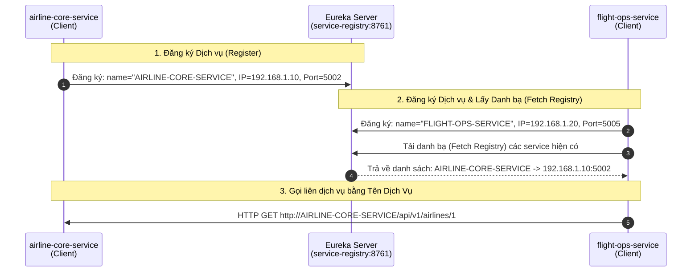

# Service Discovery với Netflix Eureka (Eureka Server & Client)

> **Trạng thái**: 🟢 **Đã khởi tạo hạ tầng Eureka** | 🟡 **Chuẩn bị tích hợp OpenFeign**  
> **Tài liệu liên quan**: Bám theo [`ROADMAP.md`](../ROADMAP.md) Section 14 (Eureka Service Discovery) và [`CLAUDE.md`](../../CLAUDE.md).

---

## 1. Ẩn dụ Thực tế: Danh bạ Điện thoại (Contact List Analogy)

| Cách tiếp cận | Ví dụ Thực tế | Trong Microservices | Nhược điểm |
| :--- | :--- | :--- | :--- |
| **Hardcoded URL** | Học thuộc lòng số điện thoại của 50 người bạn. | Gõ cứng `http://localhost:5002` vào code `RestTemplate`. | Người bạn đổi số $\rightarrow$ Mất liên lạc. Service đổi Port/IP $\rightarrow$ Hệ thống gãy. |
| **Service Discovery (Eureka)** | Lưu tên bạn vào Danh bạ (`"Rahul"`). Khi gọi chỉ cần bấm "Gọi Rahul", điện thoại tự tìm số. | Đăng ký dịch vụ với tên `AIRLINE-CORE-SERVICE`. Khi gọi chỉ cần gọi tên dịch vụ, Eureka tự phân giải IP/Port. | Không quan tâm IP/Port thay đổi thế nào, chỉ cần nhớ Tên Dịch Vụ. |

---

## 2. Mô hình Hoạt động của Eureka Service Discovery



---

## 3. Các bước Khởi tạo Eureka Server (`service-registry`)

### 3.1. Thêm Dependency (`pom.xml`)
Trong module `cloud/service-registry`:

```xml
<dependency>
    <groupId>org.springframework.cloud</groupId>
    <artifactId>spring-cloud-starter-netflix-eureka-server</artifactId>
</dependency>
```

### 3.2. Bật Eureka Server trên Main Class
Thêm annotation `@EnableEurekaServer` tại `ServiceRegistryApplication.java`:

```java
package com.nitditto;

import org.springframework.boot.SpringApplication;
import org.springframework.boot.autoconfigure.SpringBootApplication;
import org.springframework.cloud.netflix.eureka.server.EnableEurekaServer;

@SpringBootApplication
@EnableEurekaServer // Biến ứng dụng Spring Boot này thành Eureka Service Registry
public class ServiceRegistryApplication {
    public static void main(String[] args) {
        SpringApplication.run(ServiceRegistryApplication.class, args);
    }
}
```

### 3.3. Cấu hình `application.yaml` cho Eureka Server
Mặc định Eureka Server là cổng `8761`. Ta cần vô hiệu hóa tính năng tự đăng ký chính nó:

```yaml
server:
  port: 8761

spring:
  application:
    name: service-registry

eureka:
  client:
    register-with-eureka: false # Không cho phép Eureka Server tự đăng ký chính mình làm client
    fetch-registry: false       # Không cần tải danh bạ từ server khác về
```

> **Dashboard**: Sau khi khởi chạy, truy cập `http://localhost:8761` để xem giao diện quản trị (Eureka Dashboard).

---

## 4. Cấu hình Microservices thành Eureka Client

Mọi Microservice cần tham gia vào mạng lưới (ví dụ: `airline-core-service`, `flight-ops-service`) sẽ được cấu hình thành **Eureka Client**.

### 4.1. Thêm Dependency (`pom.xml`)
Tại `pom.xml` của từng microservice:

```xml
<dependency>
    <groupId>org.springframework.cloud</groupId>
    <artifactId>spring-cloud-starter-netflix-eureka-client</artifactId>
</dependency>
```

### 4.2. Cấu hình `application.yaml` cho Eureka Client

```yaml
spring:
  application:
    name: airline-core-service # TÊN ĐỊNH DANH DỊCH VỤ - Rất quan trọng!

eureka:
  client:
    register-with-eureka: true # Đăng ký service này lên Eureka Server
    fetch-registry: true       # Lấy danh sách các service khác về local cache
    service-url:
      defaultZone: http://localhost:8761/eureka/ # Địa chỉ của Eureka Server
  instance:
    prefer-ip-address: true    # Ưu tiên sử dụng địa chỉ IP thay vì Hostname (ổn định hơn trên Cloud)
```

> **Lưu ý**: Từ Spring Cloud các phiên bản mới, **không bắt buộc** phải gắn `@EnableDiscoveryClient` ở Main Class nữa. Việc khai báo dependency `spring-cloud-starter-netflix-eureka-client` sẽ tự động bật tính năng Discovery Client.

---

## 5. Kết quả trên Dashboard & Tiền đề cho Feign Client

1. **Trên Dashboard (`http://localhost:8761`)**:
   Khi `airline-core-service` và `flight-ops-service` khởi chạy, chúng sẽ tự động báo danh tới Eureka Server và xuất hiện tại mục **Instances currently registered with Eureka**:
   - `AIRLINE-CORE-SERVICE` $\rightarrow$ Running on port 5002
   - `FLIGHT-OPS-SERVICE` $\rightarrow$ Running on port 5005

2. **Tiền đề cho bài học tiếp theo (OpenFeign / Feign Client)**:
   - Hiện tại Eureka đã giúp quản lý "Danh bạ" vị trí của tất cả các service.
   - Ở bài tiếp theo, ta sẽ dùng **OpenFeign (Feign Client)** để thay thế hoàn toàn `RestTemplate` và chuỗi URL hardcoded bằng các Java Interface khai báo ngắn gọn.
