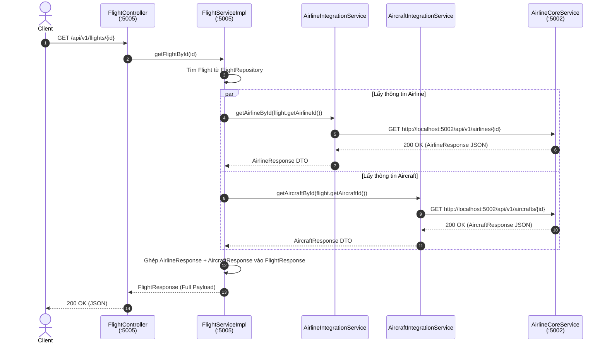

# Giao tiếp Liên Dịch vụ (Inter-Service Communication)

> **Trạng thái**: 🟢 **Đã triển khai thử nghiệm (RestTemplate)** | 🟡 **Cần nâng cấp (Eureka + OpenFeign)**  
> **Tài liệu liên quan**: Bám theo [`ROADMAP.md`](../ROADMAP.md) Section 14 (Eureka Service Discovery & Feign) và [`CLAUDE.md`](../../CLAUDE.md).

---

## 1. Tổng quan & Lý do Cần thiết

Trong kiến trúc Microservices của hệ thống Airline, mỗi microservice áp dụng chiến lược **Database-per-Service**:
- **`airline-core-service`** (Port `5002`): Nắm giữ duy nhất dữ liệu về **Hãng hàng không (`Airline`)** và **Tàu bay (`Aircraft`)**.
- **`flight-ops-service`** (Port `5005`): Nắm giữ thông tin **Chuyến bay (`Flight`)** và **Instance chuyến bay (`FlightInstance`)**.

### Bài toán Data Normalization vs. Data Enrichment
Để tránh dư thừa dữ liệu và vi phạm tính đóng gói domain, entity `Flight` trong `flight-ops-service` **không lưu trữ** các thuộc tính như tên hãng bay (`airlineName`), logo (`logoUrl`), mẫu tàu bay (`aircraftModel`). Tệp cơ sở dữ liệu của `flight-ops-service` chỉ lưu trữ các cột ID tham chiếu dạng `Long`: `airlineId`, `aircraftId`.

```
Flight Entity (flight-ops-service)
├── id: Long
├── flightNumber: String
├── airlineId: Long      <-- Chỉ lưu ID tham chiếu (FK Cross-Service)
├── aircraftId: Long     <-- Chỉ lưu ID tham chiếu (FK Cross-Service)
└── status: FlightStatus
```

**Thách thức**: Khi Client gọi API lấy chi tiết chuyến bay `GET /api/v1/flights/{id}`, họ yêu cầu một Response DTO hoàn chỉnh (gồm tên hãng, logo, mã IATA, model máy bay...) chứ không thể chỉ nhận về các con số ID vô nghĩa.

**Giải pháp**: `flight-ops-service` phải đóng vai trò truy vấn liên dịch vụ (Inter-Service Communication) sang `airline-core-service` để thu thập dữ liệu chi tiết và **enrich** (làm giàu) đối tượng `FlightResponse` trước khi trả về Client.

---

## 2. Kiến trúc & Sơ đồ Luồng Thực thi (Sequence Diagram)

Sơ đồ trình bày toàn bộ luồng giao tiếp đồng bộ (Synchronous HTTP REST) giữa các dịch vụ trong hệ thống:



---

## 3. Triển khai Chi tiết trong Codebase

### 3.1. Cấu hình Bean `RestTemplate` (`AppConfig`)

Tại `flight-ops-service`, đăng ký `RestTemplate` làm một Spring Bean trong lớp cấu hình `AppConfig`:

```java
package com.nitditto.config;

import org.springframework.context.annotation.Bean;
import org.springframework.context.annotation.Configuration;
import org.springframework.web.client.RestTemplate;

@Configuration
public class AppConfig {

    @Bean
    public RestTemplate restTemplate() {
        return new RestTemplate();
    }
}
```

---

### 3.2. Xây dựng Integration Layer (`inter-service`)

Để giữ lớp `FlightServiceImpl` tập trung vào nghiệp vụ chuyến bay, toàn bộ logic giao tiếp HTTP ngoài service được đưa vào gói `com.nitditto.service.interservice`:

#### `AirlineIntegrationService.java`
```java
package com.nitditto.service.interservice;

import com.nitditto.dto.response.AirlineResponse;
import lombok.RequiredArgsConstructor;
import org.springframework.stereotype.Service;
import org.springframework.web.client.RestTemplate;

@Service
@RequiredArgsConstructor
public class AirlineIntegrationService {

    private final RestTemplate restTemplate;

    public AirlineResponse getAirlineById(Long id) {
        String url = "http://localhost:5002/api/v1/airlines/" + id;
        return this.restTemplate.getForObject(url, AirlineResponse.class);
    }
}
```

#### `AircraftIntegrationService.java`
```java
package com.nitditto.service.interservice;

import com.nitditto.dto.response.AircraftResponse;
import lombok.RequiredArgsConstructor;
import org.springframework.stereotype.Service;
import org.springframework.web.client.RestTemplate;

@Service
@RequiredArgsConstructor
public class AircraftIntegrationService {

    private final RestTemplate restTemplate;

    public AircraftResponse getAircraftById(Long id) {
        String url = "http://localhost:5002/api/v1/aircrafts/" + id;
        return this.restTemplate.getForObject(url, AircraftResponse.class);
    }
}
```

---

### 3.3. Enrich DTO tại `FlightServiceImpl`

Trong `FlightServiceImpl`, thay vì khởi tạo các đối tượng Dummy/Stub, tiến hành tiêm (inject) các Integration Services để lấy thông tin thực tế:

```java
@Service
@RequiredArgsConstructor
public class FlightServiceImpl implements FlightService {

    private final FlightRepository flightRepository;
    private final AirlineIntegrationService airlineIntegrationService;
    private final AircraftIntegrationService aircraftIntegrationService;

    private FlightResponse convertToFLightResponse(final Flight flight) {
        // 1. Gọi HTTP lấy chi tiết Aircraft từ airline-core-service
        final AircraftResponse aircraftResponse = 
            this.aircraftIntegrationService.getAircraftById(flight.getAircraftId());

        // 2. Gọi HTTP lấy chi tiết Airline từ airline-core-service
        final AirlineResponse airlineResponse = 
            this.airlineIntegrationService.getAirlineById(flight.getAirlineId());

        // 3. Tổng hợp thành FlightResponse DTO
        return FlightResponse.builder()
            .id(flight.getId())
            .flightNumber(flight.getFlightNumber())
            .airline(airlineResponse)
            .aircraft(aircraftResponse)
            .build();
    }
}
```

---

## 4. Hạn chế & Các Vấn đề Thực tế (Known Drawbacks)

Mặc dù `RestTemplate` đáp ứng nhu cầu giao tiếp cơ bản, việc **Hardcode URL và Port** bộc lộ các rủi ro lớn trong phát triển và triển khai thực tế:

| Vấn đề | Chi tiết tác động |
| :--- | :--- |
| **1. Nhầm lẫn Port khi phát triển (Human Error)** | Lập trình viên dễ gõ sai Port giữa các service (ví dụ gõ nhầm `5005` thay vì `5002`), dẫn đến lỗi `Connection Refused` hoặc `404 Resource Not Found`. |
| **2. Tải chi phí bảo trì (Find & Replace Nightmare)** | Khi một service đổi Port (ví dụ: `5002` $\rightarrow$ `5003`), phải đi cập nhật chuỗi URL thủ công ở tất cả các lớp Integration trong hệ thống. |
| **3. Không tương thích Cloud/Docker (Dynamic IP)** | Trong môi trường Production (AWS, Kubernetes, Docker), không tồn tại `localhost`. Mỗi Container/Pod được cấp một IP ĐỘNG tự động thay đổi sau mỗi lần khởi động lại. |
| **4. Thiếu Cân bằng tải (Load Balancing)** | Nếu `airline-core-service` được nhân bản (scale out) thành 3 instance chạy ở 3 port khác nhau, `RestTemplate` tĩnh không thể phân phối tải giữa các instance này. |

---

## 5. Lộ trình Nâng cấp Kiến trúc (Architecture Roadmap)

Để giải quyết triệt để các hạn chế trên, hệ thống tuân theo 3 giai đoạn tiến hóa trong [`ROADMAP.md`](../ROADMAP.md):

```
┌───────────────────────────┐      ┌───────────────────────────┐      ┌───────────────────────────┐
│ Giai đoạn 1 (Hiện tại)    │      │ Giai đoạn 2 (Tiếp theo)   │      │ Giai đoạn 3 (Hoàn thiện)  │
│                           │      │                           │      │                           │
│ RestTemplate              │ ===> │ RestTemplate + Eureka     │ ===> │ Spring Cloud OpenFeign    │
│ + Hardcoded URL           │      │ + Service Discovery       │      │ + Resiliency (CircuitBkr) │
│ (http://localhost:5002)   │      │ (http://AIRLINE-SERVICE)  │      │ Declarative Interfaces    │
└───────────────────────────┘      └───────────────────────────┘      └───────────────────────────┘
```

### Bước 1: Tích hợp Eureka Service Discovery (Section 14)
- Mọi microservice tự đăng ký tên ứng dụng (Service Name) với Eureka Server (vd: `AIRLINE-CORE-SERVICE`).
- Thay thế địa chỉ tĩnh bằng tên dịch vụ:
  ```java
  // Thay thế http://localhost:5002/api/v1/airlines/
  String url = "http://AIRLINE-CORE-SERVICE/api/v1/airlines/" + id;
  ```
- Thêm annotation `@LoadBalanced` vào `RestTemplate` Bean để tự động tra cứu IP và cân bằng tải client-side.

### Bước 2: Chuyển đổi sang Declarative Client với Spring Cloud OpenFeign
Thay vì phải tự inject `RestTemplate` và nối chuỗi URL, chuyển sang khai báo Interface sạch sẽ:

```java
@FeignClient(name = "AIRLINE-CORE-SERVICE")
public interface AirlineClient {

    @GetMapping("/api/v1/airlines/{id}")
    AirlineResponse getAirlineById(@PathVariable("id") Long id);
}
```

---

## 6. Quy tắc Tuân thủ Convention Repo (`CLAUDE.md`)

Khi triển khai Inter-Service Communication, các lập trình viên bắt buộc tuân thủ các quy tắc sau:

1. **Tránh N+1 HTTP Request trong Vòng lặp**:
   - **CẤM**: Gọi HTTP từng phần tử bên trong vòng lặp `for`/`stream` (ví dụ: lặp danh sách 50 chuyến bay và gọi 50 lần HTTP request lấy Airline).
   - **BẮT BUỘC**: Xây dựng endpoint Batch ở service đích (`POST /api/v1/airlines/batch-by-ids`) và gọi 1 HTTP request duy nhất để lấy danh sách.
2. **Xử lý Lỗi ngoại lệ Cross-Service**:
   - Nếu service đích trả về `404 Not Found` hoặc bị ngắt kết nối (Timeout), Integration Service không được làm ngắt đột ngột (crash) service gọi.
   - Cần bắt lỗi hoặc cấu hình Fallback DTO hợp lý thông qua `GlobalExceptionHandler` hoặc Resilience4j.
3. **Cấu hình Timeout cho HTTP Call**:
   - Luôn thiết lập `ConnectTimeout` và `ReadTimeout` cho `RestTemplate` để tránh tình trạng treo Thread Pool khi service đích phản hồi chậm.
