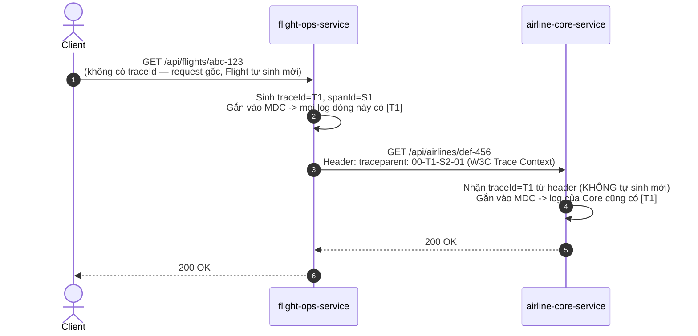

# Observability — Logging, Distributed Tracing & Metrics

> **Trạng thái**: ⬜ **Chưa triển khai** — repo hiện chỉ có `show-sql`/`org.hibernate.SQL: DEBUG`
> (dùng để đếm N+1 query, xem [`../../CLAUDE.md`](../../CLAUDE.md) §7) và `@Slf4j` log rời rạc theo
> từng service. Chưa có Micrometer Tracing, Zipkin, hay Prometheus/Grafana ở bất kỳ đâu.
> **Tài liệu liên quan**: [`ROADMAP.md`](../ROADMAP.md) Section 23 · [`spring-cloud-service-discovery.md`](spring-cloud-service-discovery.md) ·
> [`openfeign-client.md`](openfeign-client.md) · [`../../CLAUDE.md`](../../CLAUDE.md).

---

## 1. 5W1H

| | Trả lời |
| :--- | :--- |
| **What** — Là gì? | Ba trụ cột bổ sung cho nhau: **Logging** (chuyện gì đã xảy ra, dạng text/JSON), **Distributed Tracing** (một request đi qua những service nào, mất bao lâu ở mỗi chặng — Micrometer Tracing + Zipkin), **Metrics** (số liệu tổng hợp theo thời gian — request/s, latency p99, tỉ lệ lỗi — Micrometer + Prometheus + Grafana). |
| **Why** — Tại sao cần, và tại sao cần **ngay khi** có ≥ 2 service gọi nhau? | Log riêng lẻ của từng service (hiện tại) chỉ trả lời "service này đã làm gì", không trả lời được "vì sao `GET /api/flights/{id}` mất 2 giây" khi câu trả lời nằm ở **service khác** (`airline-core-service` đang chậm) mà không có cách nào nối 2 log lại với nhau. Không có tracing, debug một request xuyên nhiều service = mở log từng service, tự đoán theo timestamp — không khả thi khi hệ thống có 7+ service. |
| **Who** — Ai cần quan tâm? | Toàn bộ service có tham gia gọi lẫn nhau (hiện tại: `flight-ops-service` ↔ `airline-core-service`), không phải một service riêng lẻ như Eureka/Gateway. Đây là lý do observability luôn phải triển khai **đồng loạt** cho mọi service, thiếu 1 service là đứt chuỗi trace tại đó. |
| **When** — Khi nào bắt buộc, khi nào chưa cấp thiết? | Bắt buộc ngay khi có ≥ 2 service gọi HTTP lẫn nhau qua Gateway/Feign/Kafka (đúng tình huống hiện tại của dự án, dù chưa triển khai). Logging cơ bản (`@Slf4j`) luôn cần dù chỉ có 1 service; Tracing chỉ có giá trị khi có **nhiều hơn 1** service tham gia 1 request. |
| **Where** — Đặt ở đâu? | Cấu hình `application.yaml` (Micrometer Tracing) áp dụng **đồng nhất cho mọi service** — nên đặt các property chung này ở một nơi kế thừa được thay vì copy-paste 7 lần (xem §5). Zipkin/Prometheus/Grafana là hạ tầng riêng, chạy độc lập ngoài reactor Maven (giống MySQL). |
| **How** — Vận dụng ra sao? | Xem §3 (Correlation ID/Trace ID), §4 (Structured Logging), §5 (Metrics). |

---

## 2. Vấn đề cụ thể: một request, nhiều service, một câu hỏi không trả lời được

```
Client → flight-ops-service → airline-core-service
              (log riêng)         (log riêng)
```

Log hiện tại của `flight-ops-service` (giả sử):
```
2026-09-17 10:00:01 INFO  FlightServiceImpl - Fetching flight id=abc-123
```

Log của `airline-core-service` tại cùng thời điểm, phục vụ **hàng chục request khác nhau đang chạy
song song**:
```
2026-09-17 10:00:01 INFO  AirlineServiceImpl - Fetching airline id=def-456
2026-09-17 10:00:01 INFO  AircraftServiceImpl - Fetching aircraft id=ghi-789
2026-09-17 10:00:01 WARN  AirlineServiceImpl - Airline not found id=xyz-999
```

**Không có cách nào biết dòng `WARN` ở trên có liên quan tới request `abc-123` hay không** — chỉ
dựa vào timestamp là đoán mò. Đây chính xác là vấn đề mà **Correlation ID / Trace ID** giải quyết:
gắn cùng 1 định danh vào mọi log của mọi service tham gia xử lý **cùng một request gốc**.

---

## 3. Correlation ID / Trace ID — cơ chế lan truyền



Với Micrometer Tracing (thư viện thay thế Spring Cloud Sleuth đã ngừng phát triển từ Spring Boot 3),
việc sinh + lan truyền `traceId` qua header HTTP (`RestTemplate`/`Feign` đều tự động instrument) và
gắn vào MDC (Mapped Diagnostic Context) của SLF4J là **tự động, không cần viết interceptor thủ
công** — chỉ cần đúng dependency + cấu hình log pattern in ra `traceId`.

### Dependency (áp dụng cho mọi service tham gia gọi nhau)

```xml
<dependency>
    <groupId>io.micrometer</groupId>
    <artifactId>micrometer-tracing-bridge-brave</artifactId>
</dependency>
<dependency>
    <groupId>io.zipkin.reporter2</groupId>
    <artifactId>zipkin-reporter-brave</artifactId>
</dependency>
```

### Cấu hình `application.yaml`

```yaml
management:
  tracing:
    sampling:
      probability: 1.0   # dev: log 100% request. Production nên hạ (vd. 0.1) để giảm overhead
  zipkin:
    tracing:
      endpoint: http://localhost:9411/api/v2/spans

logging:
  pattern:
    level: "%5p [${spring.application.name},%X{traceId:-},%X{spanId:-}]"
```

Log sau khi cấu hình:
```
2026-09-17 10:00:01  INFO [flight-ops-service,T1,S1] FlightServiceImpl - Fetching flight id=abc-123
2026-09-17 10:00:01  INFO [airline-core-service,T1,S2] AirlineServiceImpl - Fetching airline id=def-456
```

Giờ có thể `grep T1` trên log tổng hợp của **mọi** service (sau khi gom về một chỗ — xem §4.2) để
thấy toàn bộ hành trình của đúng 1 request.

### Xem trace trực quan trên Zipkin UI

Chạy Zipkin (`docker run -d -p 9411:9411 openzipkin/zipkin` — cần Docker, chưa có trong repo theo
[Section 16](../ROADMAP.md)), truy cập `http://localhost:9411`, tìm theo `traceId` để xem waterfall:
chặng nào (`flight-ops-service` hay `airline-core-service`) chiếm bao nhiêu ms — trả lời trực tiếp
câu hỏi "vì sao request này chậm" mà không cần đoán.

---

## 4. Structured Logging

### 4.1. Vì sao log dạng text đơn giản không đủ khi có nhiều service

Log text (`2026-09-17 10:00:01 INFO ...`) dễ đọc bằng mắt nhưng khó **query** khi tổng hợp log của
7 service vào một hệ thống chung (ELK/Grafana Loki) — ví dụ không dễ trả lời "đếm số request lỗi
`ResourceNotFoundException` trong 1 giờ qua, theo từng service". Structured logging (JSON) giải
quyết việc này bằng cách mỗi dòng log là 1 object có field rõ ràng, query được như một bảng dữ liệu.

```json
{"timestamp":"2026-09-17T10:00:01Z","level":"WARN","service":"airline-core-service","traceId":"T1","logger":"AirlineServiceImpl","message":"Airline not found id=xyz-999"}
```

### 4.2. Áp dụng cho `GlobalExceptionHandler` hiện có

Mỗi service đã có `GlobalExceptionHandler` riêng (theo [`../../CLAUDE.md`](../../CLAUDE.md) §12).
Đây chính là nơi tự nhiên nhất để đảm bảo **mọi** exception nghiệp vụ đều được log có cấu trúc,
kèm `traceId` (tự động có trong MDC nhờ §3), trước khi trả lỗi chung chung về client:

```java
@ExceptionHandler(Exception.class)
public ResponseEntity<ApiResponse<Void>> handleUnexpected(final Exception ex) {
    // traceId đã tự động có trong MDC nhờ Micrometer Tracing — log pattern ở §3 sẽ tự in kèm,
    // không cần truyền tay traceId vào log.error() ở mỗi chỗ gọi
    log.error("Unexpected error", ex);
    return ResponseEntity.status(HttpStatus.INTERNAL_SERVER_ERROR)
        .body(ApiResponse.error("Internal server error"));
}
```

### 4.3. Log ra JSON (Logback encoder)

```xml
<!-- logback-spring.xml -->
<appender name="JSON" class="ch.qos.logback.core.ConsoleAppender">
    <encoder class="net.logstash.logback.encoder.LogstashEncoder">
        <includeMdcKeyName>traceId</includeMdcKeyName>
        <includeMdcKeyName>spanId</includeMdcKeyName>
    </encoder>
</appender>
```

Cần thêm `logstash-logback-encoder` vào `pom.xml`. Chỉ nên bật JSON ở môi trường có hệ thống tổng
hợp log phía sau (ELK/Loki) — ở máy dev, log text (mặc định Spring Boot) vẫn dễ đọc hơn nhiều.

---

## 5. Metrics — Prometheus & Grafana

Khác biệt với Tracing: Tracing trả lời cho **1 request cụ thể**, Metrics trả lời **xu hướng theo
thời gian** — "P99 latency của `GET /api/flights` trong 24h qua", "tỉ lệ lỗi 5xx của
`airline-core-service` tăng từ lúc nào".

### 5.1. Dependency

```xml
<dependency>
    <groupId>org.springframework.boot</groupId>
    <artifactId>spring-boot-starter-actuator</artifactId>
</dependency>
<dependency>
    <groupId>io.micrometer</groupId>
    <artifactId>micrometer-registry-prometheus</artifactId>
</dependency>
```

### 5.2. Cấu hình expose endpoint

```yaml
management:
  endpoints:
    web:
      exposure:
        include: health, prometheus, metrics
  endpoint:
    health:
      show-details: when-authorized   # KHÔNG dùng "always" ở production — lộ chi tiết hạ tầng nội bộ
```

Prometheus scrape định kỳ `GET /actuator/prometheus` của **từng service** (mỗi service tự expose,
không cần agent riêng), Grafana đọc từ Prometheus để vẽ dashboard.

### 5.3. Số liệu nên theo dõi đầu tiên (4 Golden Signals)

| Signal | Ý nghĩa | Nguồn trong dự án |
| :--- | :--- | :--- |
| **Latency** | Request mất bao lâu | `http.server.requests` (tự động có nhờ Actuator, tag theo `uri`, `status`) |
| **Traffic** | Bao nhiêu request/giây | Cùng metric trên, đếm theo `count` |
| **Errors** | Tỉ lệ request lỗi (4xx/5xx) | Cùng metric trên, filter theo tag `status` |
| **Saturation** | Tài nguyên (thread pool, DB connection pool) đang dùng bao nhiêu % | `hikaricp.connections.active`/`hikaricp.connections.max` — quan trọng vì mỗi service đang tự quản 1 connection pool MySQL riêng (database-per-service) |

### 5.4. Vì sao phải làm sau khi đã có Resilience4j

Circuit breaker (xem [`resilience-fault-tolerance.md`](resilience-fault-tolerance.md)) tự expose
metric `resilience4j.circuitbreaker.state` khi có Actuator + Micrometer — nghĩa là **thứ tự triển
khai hợp lý** là: Tracing/Logging trước (để debug được), Resilience4j kế tiếp (để hệ thống tự chịu
lỗi), Metrics/Grafana sau cùng (để giám sát cả hai cái trên hoạt động đúng theo thời gian) — không
nên làm dashboard Grafana đẹp trước khi hệ thống có gì đáng tin cậy để đo.

---

## 6. Thứ tự triển khai đề xuất cho dự án này

1. **Structured logging + `traceId` trong log pattern** (§3, §4) — chi phí thấp nhất, giá trị ngay
   lập tức khi debug `flight-ops-service` ↔ `airline-core-service`.
2. **Zipkin** — chỉ cần khi bắt đầu thấy khó debug latency xuyên service bằng mắt thường.
3. **Actuator + Prometheus + Grafana** — khi hệ thống chạy liên tục đủ lâu để "xu hướng theo thời
   gian" có ý nghĩa (không cần thiết khi còn đang phát triển tính năng, giá trị đến khi vận hành).
