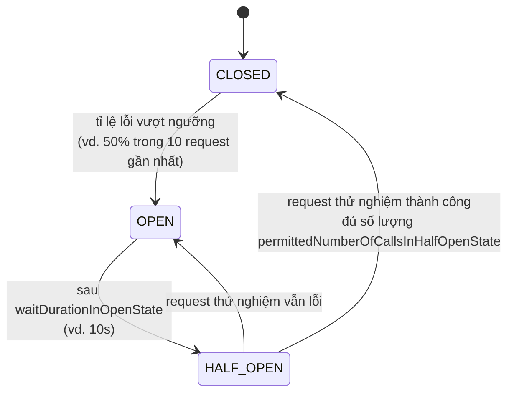

# Resilience & Fault Tolerance (Resilience4j)

> **Trạng thái**: ⬜ **Chưa triển khai** — repo hiện chưa có dependency `resilience4j-spring-boot3`
> ở bất kỳ service nào. File này là tài liệu thiết kế cho [`ROADMAP.md`](../ROADMAP.md) Section 13,
> mục 6. **Không tự thêm code khi chưa được yêu cầu** — theo [`../../CLAUDE.md`](../../CLAUDE.md)
> mục "Ngoài phạm vi kiến trúc hiện tại".
> **Tài liệu liên quan**: [`spring-cloud-service-discovery.md`](spring-cloud-service-discovery.md) ·
> [`openfeign-client.md`](openfeign-client.md) · [`inter-service-communication.md`](inter-service-communication.md).

---

## 1. 5W1H

| | Trả lời |
| :--- | :--- |
| **What** — Là gì? | Một tập pattern (Circuit Breaker, Retry, Fallback, Bulkhead, Rate Limiter, Time Limiter) chặn lỗi ở **một** service để nó không lan (cascading failure) sang toàn hệ thống. Thư viện dùng: **Resilience4j** (kế thừa tinh thần Netflix Hystrix, nhưng Hystrix đã ngừng phát triển). |
| **Why** — Tại sao cần? | Ngay khi có Eureka + gọi HTTP giữa các service (đã có), một service con chết hoặc chậm **sẽ** kéo theo service gọi nó bị treo request, cạn thread pool, rồi tới lượt *nó* cũng không phản hồi được cho service gọi *nó* — đổ domino toàn hệ thống chỉ vì 1 service lỗi. Đây không phải rủi ro giả định: `flight-ops-service` phụ thuộc trực tiếp vào `airline-core-service` để trả `FlightResponse`; nếu `airline-core-service` down, mọi request `GET /api/flights` cũng chết theo nếu không có fallback. |
| **Who** — Ai cần áp dụng? | **Service gọi** (caller) — tức mọi nơi có `RestTemplate`/`Feign client` gọi sang service khác. Hiện tại là `flight-ops-service` (gọi `airline-core-service`, `location-service`). Service bị gọi không cần biết gì về Resilience4j. |
| **When** — Khi nào dùng? | Khi một request tới service A **có** một giá trị fallback chấp nhận được (ví dụ: trả `airline: null` thay vì lỗi 500 toàn bộ). **Không dùng thay cho việc sửa lỗi gốc** — nếu service đích lỗi logic (bug thật), circuit breaker chỉ che triệu chứng, không phải giải pháp. |
| **Where** — Đặt ở đâu trong repo? | Bọc quanh method của `AircraftIntegrationService`/`AirlineIntegrationService` (hoặc `AirlineClient`/`LocationClient` nếu chuyển sang Feign — xem [`openfeign-client.md`](openfeign-client.md) §6) bằng annotation `@CircuitBreaker`/`@Retry`. Cấu hình threshold khai trong `application.yaml`, namespace theo tên instance tự đặt (không nhất thiết trùng tên Eureka service). |
| **How** — Vận dụng ra sao? | Xem §3, §4, §5. |

---

## 2. Vấn đề cụ thể mà nó giải quyết trong repo này

`AircraftIntegrationService`/`AirlineIntegrationService` (RestTemplate) hiện đã có try/catch quanh
`RestClientException`, trả `null`/`Map.of()` khi lỗi — đây là **hình thức fallback thủ công, đơn
giản nhất**. Vấn đề của cách làm thủ công này:

1. **Không có circuit breaker** — mỗi request tới `flight-ops-service` vẫn tiếp tục gọi
   `airline-core-service` dù nó đang down, mỗi lần đều đợi hết `readTimeout` (hiện là 5 giây) rồi
   mới fail. 100 request đồng thời = 100 thread bị giữ 5 giây mỗi cái, dù biết chắc sẽ lỗi.
2. **Không phân biệt "lỗi thoáng qua" và "lỗi kéo dài"** — không tự động ngừng gọi khi tỉ lệ lỗi
   cao, cũng không tự động thử lại khi service đã hồi phục.
3. **Fallback rời rạc, không đo lường được** — không biết tỉ lệ request đang fallback là bao nhiêu,
   không có ngưỡng cảnh báo.

Resilience4j giải quyết cả 3 điểm trên bằng cấu hình khai báo, tách khỏi logic nghiệp vụ.

---

## 3. Circuit Breaker — trạng thái và cách chuyển



| Trạng thái | Hành vi |
| :--- | :--- |
| **CLOSED** | Bình thường — mọi request đi thẳng tới `airline-core-service`. |
| **OPEN** | Ngừng gọi hoàn toàn trong `waitDurationInOpenState` — trả fallback **ngay lập tức**, không tốn thời gian chờ timeout. |
| **HALF_OPEN** | Cho một số ít request "thử nghiệm" đi qua để kiểm tra service đích đã hồi phục chưa. |

### Áp dụng vào `AircraftIntegrationService`

```java
@Service
@RequiredArgsConstructor
public class AircraftIntegrationService {

    private final RestTemplate restTemplate;

    @CircuitBreaker(name = "airlineCoreService", fallbackMethod = "getAircraftByIdFallback")
    @Retry(name = "airlineCoreService")
    public AircraftResponse getAircraftById(final UUID aircraftId) {
        final ResponseEntity<ApiResponse<AircraftResponse>> response = this.restTemplate.exchange(
            BASE_URL + "/" + aircraftId, HttpMethod.GET, null,
            new ParameterizedTypeReference<ApiResponse<AircraftResponse>>() { });
        return response.getBody() != null ? response.getBody().getData() : null;
    }

    // Fallback PHẢI cùng tham số + kiểu trả về, cộng thêm Throwable ở cuối
    private AircraftResponse getAircraftByIdFallback(final UUID aircraftId, final Throwable ex) {
        log.warn("Circuit breaker fallback for aircraft id={}: {}", aircraftId, ex.getMessage());
        return null; // FlightMapper.toResponse đã xử lý null aircraft, xem FlightMapper hiện tại
    }
}
```

**Thứ tự annotation quan trọng**: `@CircuitBreaker` bọc ngoài `@Retry` theo cấu hình
`application.yaml` (không phải theo thứ tự dòng code) — nghĩa là mỗi lần retry vẫn tính vào số liệu
circuit breaker. Cấu hình rõ ràng ở §4 để tránh mơ hồ.

### Cấu hình `application.yaml`

```yaml
resilience4j:
  circuitbreaker:
    instances:
      airlineCoreService:
        register-health-indicator: true
        sliding-window-size: 10               # xét 10 request gần nhất
        minimum-number-of-calls: 5             # đủ 5 request mới bắt đầu tính tỉ lệ lỗi
        failure-rate-threshold: 50             # >= 50% lỗi -> OPEN
        wait-duration-in-open-state: 10s
        permitted-number-of-calls-in-half-open-state: 3
  retry:
    instances:
      airlineCoreService:
        max-attempts: 3
        wait-duration: 200ms
        retry-exceptions:
          - org.springframework.web.client.ResourceAccessException   # timeout/connection refused
        ignore-exceptions:
          - com.nitditto.exception.ResourceNotFoundException          # 404 KHÔNG nên retry
```

---

## 4. Fallback method — quy tắc bắt buộc

1. **Chữ ký phải khớp**: cùng tham số đầu vào với method gốc, cùng kiểu trả về, thêm đúng 1 tham số
   `Throwable` (hoặc kiểu exception cụ thể hơn) ở cuối. Sai chữ ký → lỗi runtime khi Spring khởi
   động, không phải lỗi compile-time.
2. **Fallback phải là "suy giảm chấp nhận được" (graceful degradation), không phải che lỗi.** Với
   `FlightResponse`, trả `aircraft: null` là chấp nhận được vì `FlightMapper` đã xử lý null (client
   nhận flight thiếu enrich thay vì lỗi 500 toàn bộ). Với một request **ghi** dữ liệu (`POST
   /api/fares`), không có fallback "chấp nhận được" — nếu service phụ thuộc bắt buộc phải thành
   công, đừng dùng fallback im lặng, để lỗi nổi lên tới `GlobalExceptionHandler`.
3. **Log ở mức `warn`, không `error`** khi rơi vào fallback — đây là hành vi tự phục hồi có chủ
   đích của hệ thống, không phải một exception ngoài dự tính (đúng tinh thần logging convention ở
   [`../../CLAUDE.md`](../../CLAUDE.md) §15).

---

## 5. Bulkhead — cô lập tài nguyên giữa các service phụ thuộc

Circuit breaker bảo vệ khỏi *một service lỗi liên tục*. Bulkhead bảo vệ khỏi *một service chiếm hết
tài nguyên chung* (thread pool) dù chưa tới ngưỡng lỗi — ví dụ `location-service` phản hồi chậm
(chưa đủ lỗi để mở circuit) nhưng chiếm hết thread khiến request gọi `airline-core-service` (đang
khoẻ mạnh) cũng không còn thread để chạy.

```yaml
resilience4j:
  bulkhead:
    instances:
      airlineCoreService:
        max-concurrent-calls: 20   # tối đa 20 request đồng thời tới airline-core-service
      locationService:
        max-concurrent-calls: 10   # location-service được cấp riêng 10 "khoang" — lỗi ở đây
                                    # không ăn hết tài nguyên dành cho airlineCoreService
```

```java
@Bulkhead(name = "locationService", type = Bulkhead.Type.SEMAPHORE)
@CircuitBreaker(name = "locationService", fallbackMethod = "getAirportByIdFallback")
public AirportResponse getAirportById(final UUID airportId) { ... }
```

Dùng `Type.SEMAPHORE` (giới hạn số lời gọi đồng thời bằng semaphore, nhẹ) thay vì `Type.THREADPOOL`
(tạo thread pool riêng, tốn tài nguyên hơn) trừ khi có lý do cụ thể cần cô lập hoàn toàn ở cấp
thread.

---

## 6. Dependency cần thêm (khi được yêu cầu triển khai thật)

```xml
<dependency>
    <groupId>org.springframework.boot</groupId>
    <artifactId>spring-boot-starter-aop</artifactId>
</dependency>
<dependency>
    <groupId>io.github.resilience4j</groupId>
    <artifactId>resilience4j-spring-boot3</artifactId>
</dependency>
```

`spring-boot-starter-aop` bắt buộc — annotation `@CircuitBreaker`/`@Retry`/`@Bulkhead` hoạt động
qua AOP proxy, thiếu dependency này annotation bị bỏ qua **âm thầm** (không lỗi, không cảnh báo,
code chạy như chưa từng có resilience — lỗi rất khó phát hiện).

## 7. Thứ tự triển khai đề xuất

1. Bắt đầu với `AircraftIntegrationService`/`AirlineIntegrationService` — đã có sẵn cấu trúc
   try/catch để thay bằng annotation, rủi ro thấp nhất để thử nghiệm.
2. Đo bằng `register-health-indicator: true` + Actuator (`/actuator/health`) trước khi mở rộng ra
   toàn bộ service khác — tránh cấu hình threshold "đoán mò" không dựa trên số liệu thật.
3. Chỉ sau khi có Circuit Breaker ổn định mới cân nhắc Bulkhead — Bulkhead cần biết rõ tải thực tế
   (bao nhiêu request đồng thời là hợp lý) mà lúc mới triển khai thường chưa có số liệu này.
