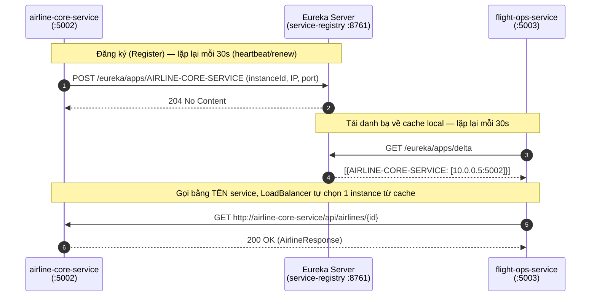

# Spring Cloud & Service Discovery (Eureka/Consul)

> **Trạng thái**: 🟢 **Eureka đã chạy** (`cloud/service-registry` + client ở `airline-core-service`,
> `flight-ops-service`) | ⬜ **Consul chưa triển khai** — chỉ nêu ở đây để so sánh khái niệm.
> **Tài liệu liên quan**: [`ROADMAP.md`](../ROADMAP.md) Section 13 · [`eureka-service-registry.md`](eureka-service-registry.md)
> (hướng dẫn cài đặt từng bước) · [`inter-service-communication.md`](inter-service-communication.md) ·
> [`../../CLAUDE.md`](../../CLAUDE.md).

File này trả lời **tại sao** dự án cần service discovery và **khi nào/ở đâu** dùng nó.
Phần "làm thế nào cài đặt" đã có chi tiết ở [`eureka-service-registry.md`](eureka-service-registry.md) —
không lặp lại ở đây.

---

## 1. 5W1H

| | Trả lời |
| :--- | :--- |
| **What** — Là gì? | Một service (`service-registry`) giữ "danh bạ" gồm tên logic ↔ IP:port thật của mọi microservice đang sống, cập nhật theo thời gian thực qua heartbeat. |
| **Why** — Tại sao cần? | Trong kiến trúc database-per-service của dự án này, `flight-ops-service` **bắt buộc** gọi HTTP sang `airline-core-service` để enrich `FlightResponse` (xem [`inter-service-communication.md`](inter-service-communication.md)). Nếu hardcode `http://localhost:5002`, hệ thống vỡ ngay khi đổi port, scale thêm instance, hoặc lên môi trường không có `localhost` (container, VPS). |
| **Who** — Ai dùng / ai sở hữu? | Mọi service **gọi** service khác (hiện tại: `flight-ops-service`) là **Eureka Client tiêu thụ registry**; mọi service **bị gọi** (hiện tại: `airline-core-service`) là **Eureka Client đăng ký**. Một service có thể vừa đăng ký vừa tiêu thụ. `service-registry` (port `8761`) chỉ đóng vai trò server, không chứa business logic. |
| **When** — Khi nào cần / khi nào không? | Cần ngay khi có ≥ 2 service gọi lẫn nhau qua HTTP (đúng tình huống hiện tại). **Không cần** cho giao tiếp nội bộ trong cùng 1 service (đó là gọi method Java bình thường), và không thay thế được API Gateway (§ [api-gateway-routing.md](api-gateway-routing.md)) hay message broker (§ [communication-patterns.md](communication-patterns.md)). |
| **Where** — Đặt ở đâu trong repo? | Server: `cloud/service-registry` (module Maven riêng, `@EnableEurekaServer`). Client: dependency `spring-cloud-starter-netflix-eureka-client` + block `eureka.client` trong `application.yaml` của **từng service** muốn tham gia — không có class Java thêm, không cần `@EnableDiscoveryClient` (Spring Cloud tự bật khi thấy dependency trên classpath). |
| **How** — Vận dụng ra sao? | Xem §3 bên dưới. Tóm tắt: đăng ký bằng `spring.application.name`, gọi nhau bằng **tên service** thay vì `host:port`, và bắt buộc `RestTemplate`/`WebClient` phải là `@LoadBalanced` (hoặc dùng Feign — tự tích hợp sẵn, xem [`openfeign-client.md`](openfeign-client.md)) thì tên đó mới được Eureka phân giải thành địa chỉ thật. |

---

## 2. Vấn đề cụ thể mà nó giải quyết trong repo này

`FlightServiceImpl.getFlightsByAirline()` trả về `Page<FlightResponse>` — mỗi `FlightResponse` cần
`airlineId`/`aircraftId` được **enrich** thành `AirlineResponse`/`AircraftResponse` đầy đủ bằng cách
gọi HTTP sang `airline-core-service`. Không có service discovery, đoạn này từng bị hardcode sai
(`http://localhost:5003/...` — gọi nhầm vào chính `flight-ops-service`, xem lịch sử sửa lỗi trong
[`inter-service-communication.md`](inter-service-communication.md) §4).

| Không có Eureka | Có Eureka |
| :--- | :--- |
| `String url = "http://localhost:5002/api/airlines/" + id;` | `String url = "http://airline-core-service/api/airlines/" + id;` |
| Đổi port `airline-core-service` → phải sửa code ở **mọi** service gọi nó | Chỉ cần đổi `server.port`, tên `airline-core-service` không đổi |
| Scale `airline-core-service` thành 3 instance → không tận dụng được | `@LoadBalanced` tự round-robin giữa các instance đăng ký cùng tên |
| Deploy container/K8s (không có `localhost` cố định) → gãy hoàn toàn | IP động không thành vấn đề, Eureka luôn biết địa chỉ mới nhất |

---

## 3. Cơ chế hoạt động (đăng ký + tra cứu + load balancing)

Ba điểm quan trọng cần nhớ:

1. **Client-side load balancing, không phải server-side.** Không có bộ cân bằng tải trung gian
   nào đứng giữa `flight-ops-service` và `airline-core-service` — chính `flight-ops-service`
   (qua `spring-cloud-starter-loadbalancer`) tự quyết định gọi vào instance nào, dựa trên cache
   registry đã tải về. Đây là lý do `@LoadBalanced` bắt buộc phải có trên `RestTemplate`.
2. **Eureka là AP, không phải CP** (theo định lý CAP): ưu tiên tính sẵn sàng hơn nhất quán. Một
   instance chết đột ngột (không kịp gửi tín hiệu huỷ đăng ký) vẫn có thể nằm trong danh bạ tới
   **90 giây** (`eureka.instance.lease-expiration-duration-in-seconds` mặc định) trước khi bị dọn.
   Client gọi trúng instance đã chết sẽ nhận lỗi kết nối — đây là lý do §resilience
   ([`resilience-fault-tolerance.md`](resilience-fault-tolerance.md)) không phải tùy chọn mà là
   phần bắt buộc đi kèm service discovery trong thực tế.
3. **`service-registry` chỉ có 1 instance, là single point of failure ở giai đoạn hiện tại.**
   Production thật cần cụm ≥ 2 Eureka server tự đăng ký chéo nhau (peer awareness) — chưa cần thiết
   ở quy mô dự án học tập này, nhưng phải biết đây là giới hạn đang chấp nhận.

---

## 4. Eureka vs Consul — vì sao chọn Eureka

Dự án dùng **Netflix Eureka** (qua `spring-cloud-starter-netflix-eureka-server/client`), không dùng
**HashiCorp Consul**. Bảng so sánh để hiểu sự đánh đổi, không phải để đổi sang Consul:

| Tiêu chí | Eureka | Consul |
| :--- | :--- | :--- |
| Hệ sinh thái | Tích hợp gốc, lâu đời nhất với Spring Cloud Netflix | Cần thêm `spring-cloud-starter-consul-discovery`, chạy agent Consul riêng (Go binary, ngoài JVM) |
| Mô hình nhất quán | AP (Available, eventually consistent) | Hỗ trợ cả health-check chủ động (không chỉ heartbeat) + KV store dùng chung làm config |
| Vận hành | Chỉ là 1 Spring Boot app — deploy như service bình thường trong reactor Maven | Cần cài đặt/patch binary riêng ngoài hệ Java, phù hợp hạ tầng đa ngôn ngữ (không chỉ Spring) |
| Phù hợp với | Hệ thống 100% Spring Boot, đơn giản hoá vận hành (đúng bối cảnh dự án) | Hệ thống polyglot (Go, Node, Java cùng tồn tại) cần 1 registry chung |

**Kết luận cho dự án này:** giữ Eureka. Toàn bộ service đều là Spring Boot, không có nhu cầu polyglot,
và Eureka đã là `spring-cloud-starter-netflix-eureka-*` — thêm Consul chỉ tăng độ phức tạp vận hành
mà không giải quyết vấn đề nào đang tồn tại. Theo quy tắc ở [`../../CLAUDE.md`](../../CLAUDE.md)
mục "Ngoài phạm vi kiến trúc hiện tại": **không tự thêm Consul** — nếu tương lai cần polyglot, hỏi
trước khi đổi.

---

## 5. Vận dụng khi thêm một service mới vào mạng lưới

Checklist ngắn (chi tiết cài đặt xem [`eureka-service-registry.md`](eureka-service-registry.md) §4):

1. Thêm `spring-cloud-starter-netflix-eureka-client` vào `pom.xml` của service (không tự ghim version — kế thừa BOM `spring-cloud-dependencies` từ root `pom.xml`, đúng [`../../CLAUDE.md`](../../CLAUDE.md) §4).
2. Đặt `spring.application.name` **đúng và duy nhất** — đây là tên mà service khác sẽ gọi tới, sai tên là gãy toàn bộ tra cứu.
3. Trỏ `eureka.client.service-url.defaultZone` về `http://localhost:8761/eureka/`.
4. Nếu service này **gọi HTTP sang service khác**: dùng `RestTemplate` phải đánh dấu `@LoadBalanced` (xem [`AutoConfig.java`](../../services/flight-ops-service/src/main/java/com/nitditto/config/AutoConfig.java) của `flight-ops-service` làm mẫu), hoặc ưu tiên khai báo `@FeignClient(name = "...")` — Feign tự tích hợp load balancer, không cần cấu hình thêm (xem [`openfeign-client.md`](openfeign-client.md)).
5. Khởi động `service-registry` **trước tiên**, sau đó mới khởi động service mới — kiểm tra nó xuất hiện tại `http://localhost:8761`.

## 6. Sai lầm thường gặp (đã xảy ra thật trong repo này)

- **Quên `@LoadBalanced`** → gọi bằng tên service (`http://airline-core-service/...`) nhưng
  `RestTemplate` không tra được DNS ảo này → `UnknownHostException`.
- **Tự ghim version Spring Cloud khác root POM** ở module con → lệch version với Spring Boot BOM,
  lỗi resolve dependency khó hiểu (đã từng xảy ra ở `cloud/service-registry/pom.xml`, xem lịch sử
  sửa lỗi trong session trước — bài học: **không khai `<dependencyManagement>` riêng trong service
  con**, luôn kế thừa từ root).
- **Coi Eureka như một Gateway**: Eureka chỉ trả *danh sách địa chỉ*, nó **không** định tuyến,
  không xác thực, không giới hạn tốc độ request. Việc đó là của [API Gateway](api-gateway-routing.md).
